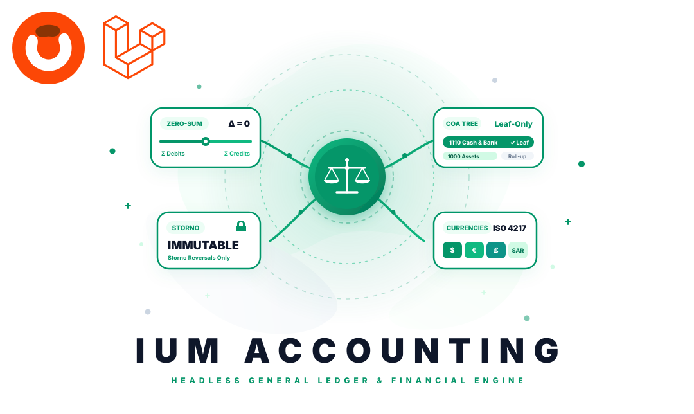

<p align="center"></p>

<p align="center">
  <a href="https://packagist.org/packages/obelaw/ium-accounting" target="_blank"></a>
  <a href="https://packagist.org/packages/obelaw/ium-accounting" target="_blank"></a>
  <a href="https://packagist.org/packages/obelaw/ium-accounting" target="_blank"></a>
  <a href="https://obelaw.com/docs/ium/accounting/introduction/" target="_blank"></a>
  <a href="https://github.com/obelaw/skill-ium-accounting-developmint" target="_blank"></a>
</p>

# Obelaw IUM Accounting (FMS)

A headless, mathematically rigorous **General Ledger and Financial Management System (FMS)** domain module for Laravel and the Obelawium ERP ecosystem.

Designed from first principles using Domain-Driven Design (DDD), `obelaw/ium-accounting` enforces the non-negotiable laws of statutory financial accounting: zero-sum integer minor unit parity, immutable ledger records, Storno reversal patterns, Maker-Checker segregation of duties, multi-currency ledger denomination, and decoupled Anti-Corruption Layer (ACL) ingestion.

---

## 📖 Documentation

Complete guides, architectural references, and fluent API specifications are available at:

👉 [**https://obelaw.com/docs/ium/accounting/introduction/**](https://obelaw.com/docs/ium/accounting/introduction/)

- [Overview & Architecture](https://obelaw.com/docs/ium/accounting/introduction/)
- [Installation & Setup](https://obelaw.com/docs/ium/accounting/installation-and-setup/)
- [Chart of Accounts (COA)](https://obelaw.com/docs/ium/accounting/chart-of-accounts/)
- [Journal Vouchers & General Ledger](https://obelaw.com/docs/ium/accounting/journal-entries-and-ledger/)
- [Fiscal Periods & Year-End Closing](https://obelaw.com/docs/ium/accounting/fiscal-periods-and-closing/)
- [Multi-Currency & Exchange Rates](https://obelaw.com/docs/ium/accounting/multi-currency-and-fx/)
- [Analytical Cost Centers](https://obelaw.com/docs/ium/accounting/analytical-cost-centers/)
- [Anti-Corruption Layer (ACL)](https://obelaw.com/docs/ium/accounting/anti-corruption-layer/)
- [Domain Invariants & Forensic Audit](https://obelaw.com/docs/ium/accounting/audit-and-invariants/)
- [Fluent API Reference](https://obelaw.com/docs/ium/accounting/api-reference/)

---

## ✨ Key Features

- **Strict Zero-Sum Parity ($\sum \text{Debits} = \sum \text{Credits}$)**: Every voucher balances perfectly down to the single integer minor unit (cents/fils). Unbalanced submissions immediately throw `UnbalancedJournalEntryException`.
- **Immutable General Ledger & Storno Reversals**: Posted vouchers (`POSTED`, `REVERSED`) are strictly immutable. Eloquent hooks prevent in-place SQL updates and deletes. Erroneous vouchers must be corrected via equal-and-opposite Storno reversal vouchers (`reverse()`).
- **Hierarchical Chart of Accounts (COA)**: Multi-level account classification tree (Assets, Liabilities, Equity, Revenue, Expense) with automated leaf-only posting validation (`NonPostingAccountException`).
- **Maker-Checker Segregation of Duties**: When strict governance is enabled, the author of a voucher (`creator_id`) cannot approve that voucher (`approver_id`), preventing unauthorized ledger adjustments.
- **Fiscal Calendar & Hard Period Locks**: Automated transaction date resolution to fiscal periods with soft review locks and statutory hard locks (`FiscalPeriodClosedException`).
- **Multi-Currency & FX Engine (ISO 4217)**: Vouchers record in original transaction currency while General Ledger postings automatically convert and persist in functional base currency minor units at posting time.
- **Multi-Dimensional Analytical Cost Centers**: Tag journal voucher lines with Cost Centers, Departments, Projects, and Business Units for granular managerial P&L breakdown without bloating the Chart of Accounts.
- **Anti-Corruption Layer (ACL)**: External operational domains (Billing, WMS, POS, Purchasing) emit domain events or call `acl()->ingest()`, insulating the General Ledger from operational logistics.
- **Statutory Year-End Closing Sequence**: Sweeps and zeroes nominal accounts (Revenues/Expenses) and rolls the net annual profit or loss directly into Retained Earnings.
- **Append-Only Forensic Audit Trail**: Tamper-proof logging of every voucher lifecycle state transition, actor ID, timestamp, IP address, and payload snapshot.

---

## 🏛 The 9 Core Domain Services

All financial capabilities are accessed through Obelawium's centralized fluent gateway:

```php
ium()->accounting()->[service]()->[method]()
```

| Service Accessor | Service Class | Primary Responsibilities |
| :--- | :--- | :--- |
| `ium()->accounting()->accounts()` | `AccountService` | Chart of Accounts hierarchy, leaf-only validation, COA tree traversal. |
| `ium()->accounting()->journalEntries()` | `JournalEntryService` | Drafting vouchers, zero-sum checking, Maker-Checker reviews, Storno reversals. |
| `ium()->accounting()->ledger()` | `LedgerService` | Immutable General Ledger book, Trial Balance, Balance Sheet, Income Statement (P&L). |
| `ium()->accounting()->fiscalPeriods()` | `FiscalPeriodService` | Fiscal years, monthly/quarterly periods, soft review locks, hard period closures. |
| `ium()->accounting()->costCenters()` | `CostCenterService` | Analytical cost dimensions (Departments, Projects, Business Units). |
| `ium()->accounting()->closing()` | `ClosingService` | Fiscal year-end nominal account zeroing and Retained Earnings rollover transfer. |
| `ium()->accounting()->audit()` | `AuditService` | Append-only forensic accounting audit logs for statutory compliance. |
| `ium()->accounting()->acl()` | `AclIngestionService` | Anti-Corruption Layer translating upstream domain events into balanced vouchers. |
| `ium()->accounting()->currencies()` | `CurrencyService` | ISO 4217 registry, daily FX rate snapshots, minor unit conversions and formatting. |

---

## 🚀 Quick Start

### 1. Installation

```bash
composer require obelaw/ium-accounting
```

### 2. Run Migrations

All accounting tables use the isolated `ium_accounting_` table prefix:

```bash
php artisan migrate
```

### 3. Seed Turnkey Demo Ledger (Optional)

Instantly stand up a balanced, multi-currency ledger with sample accounts, periods, and postings:

```bash
php artisan ium:accounting:demo-seed
```

---

## 💻 Code Examples

### Drafting & Posting a Balanced Journal Voucher

```php
use Obelaw\Ium\Accounting\Data\CreateJournalEntryDto;
use Obelaw\Ium\Accounting\Enums\JournalEntryType;

// 1. Prepare a balanced voucher using major decimal units
$dto = CreateJournalEntryDto::fromMajor([
    'entry_date'    => '2026-03-31',
    'entry_type'    => JournalEntryType::Standard,
    'currency_code' => 'USD',
    'memo'          => 'Client Q1 Retainer & Sales Tax',
    'lines' => [
        ['account_code' => '1120', 'side' => 'debit',  'amount' => 11500.00, 'memo' => 'Accounts Receivable'],
        ['account_code' => '4100', 'side' => 'credit', 'amount' => 10000.00, 'memo' => 'Consulting Revenue'],
        ['account_code' => '2150', 'side' => 'credit', 'amount' =>  1500.00, 'memo' => 'Sales Tax Payable'],
    ],
]);

// 2. Draft the voucher (saved with status = DRAFT)
$entry = ium()->accounting()->journalEntries()->createDraft($dto);

// 3. Maker-Checker Segregation: Preparer submits, distinct Controller approves and posts
ium()->accounting()->journalEntries()->submit($entry->id, $preparerId);
ium()->accounting()->journalEntries()->approve($entry->id, $controllerId);
$posted = ium()->accounting()->journalEntries()->post($entry->id, $controllerId);
```

### Immutable Storno Reversal (Never Edit in Place!)

```php
// If a posted voucher contains an error, issue an equal-and-opposite Storno reversal:
$reversal = ium()->accounting()->journalEntries()->reverse(
    entryId: $posted->id,
    actorId: $controllerId,
    reason: 'Incorrect tax calculation; reissuing updated invoice'
);
```

### Compiling Financial Statements in Real Time

```php
// 1. Real-time Trial Balance verification
$tb = ium()->accounting()->ledger()->generateTrialBalance($periodId);
if (!$tb['is_balanced']) {
    throw new RuntimeException('Trial balance disparity detected!');
}

// 2. Statutory Balance Sheet (Assets = Liabilities + Equity)
$balanceSheet = ium()->accounting()->ledger()->generateBalanceSheet();

// 3. Income Statement (P&L) for active period
$pnl = ium()->accounting()->ledger()->generateIncomeStatement($periodId);
echo "Net Profit: " . $pnl['net_income_major'];
```

### Ingesting Upstream Facts via the Anti-Corruption Layer (ACL)

```php
use Obelaw\Ium\Accounting\Data\AclIngestEventDto;

// Ingest domain event from Billing without coupling tables
$voucher = ium()->accounting()->acl()->ingest(
    new AclIngestEventDto(
        eventName: 'billing.invoice_settled',
        amountMinor: 450000, // $4,500.00 in integer cents
        currencyCode: 'USD',
        transactionDate: '2026-03-31',
        description: 'Customer INV-8921 settlement via Stripe',
        sourceType: 'billing.invoice',
        sourceId: '8921'
    )
);
```

---

## 🤖 AI Agent Pair-Programming Skill

Developing double-entry financial software requires strict adherence to domain invariants. We provide an official AI development skill tailored for **Google Antigravity**, **Claude Code**, and **Cursor**:

👉 [**https://github.com/obelaw/skill-ium-accounting-developmint**](https://github.com/obelaw/skill-ium-accounting-developmint)

Equip your AI assistants with step-by-step decision matrices, automated DTO blueprints, invariant verification procedures, and Pest PHP testing harnesses.

---

## 🤝 Contributing

Thank you for considering contributing to the Obelawium ecosystem! Please review our domain invariants and testing standards before submitting pull requests.

## 📄 License

Obelaw IUM Accounting is open-sourced software licensed under the [MIT license](https://opensource.org/licenses/MIT).
